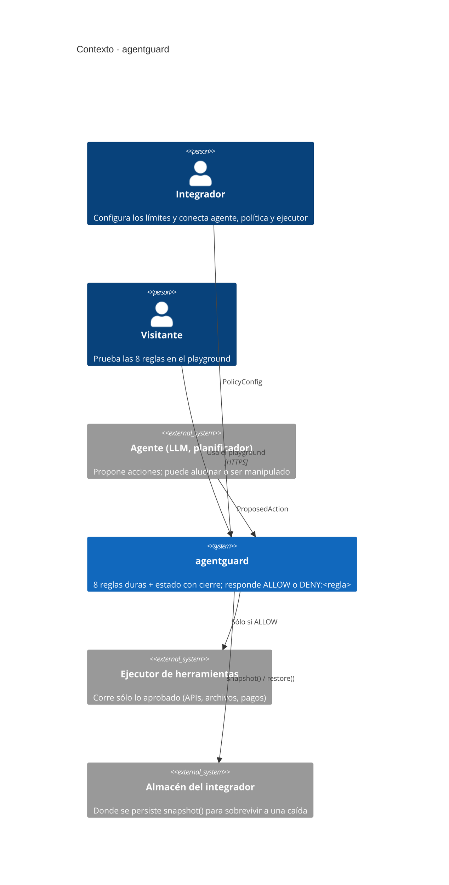
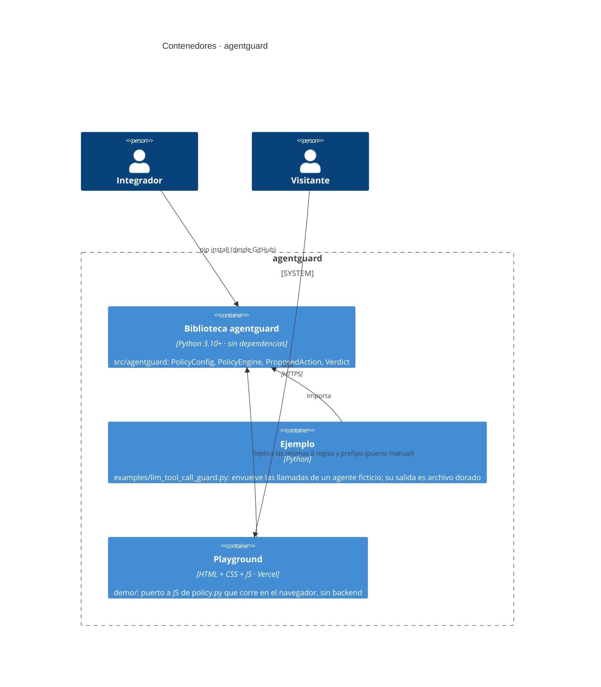
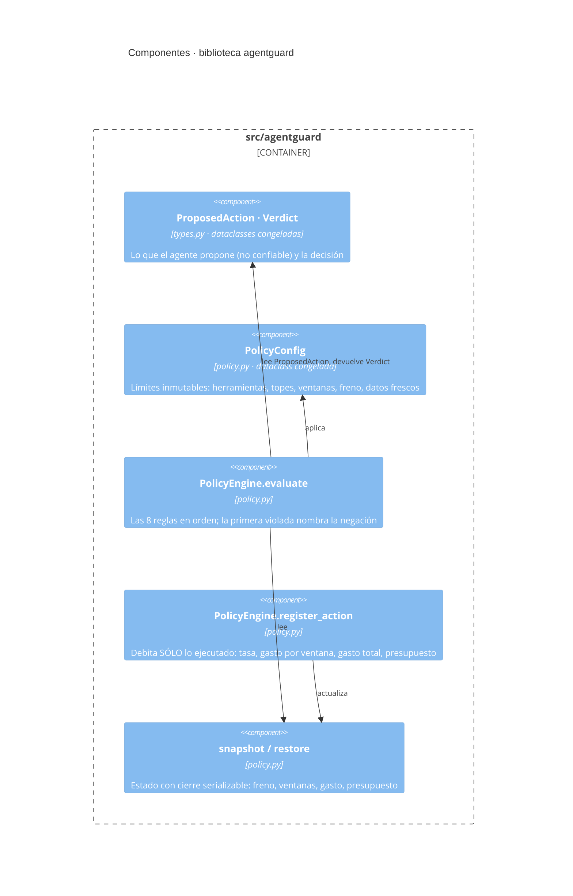

# Arquitectura · agentguard

Modelo C4: contexto → contenedores → componentes. Los diagramas son texto (Mermaid), se versionan con el código
y nombran módulos que existen. Decisiones en [`docs/adr/`](../adr/); reglas con sus pruebas en
[`docs/reglas.md`](../reglas.md).

## 1. Contexto

agentguard no es un servicio: es una biblioteca que vive **dentro** del proceso de quien la integra, entre el
agente que propone acciones y el ejecutor que las corre.

## 2. Contenedores

## 3. Componentes de la biblioteca

